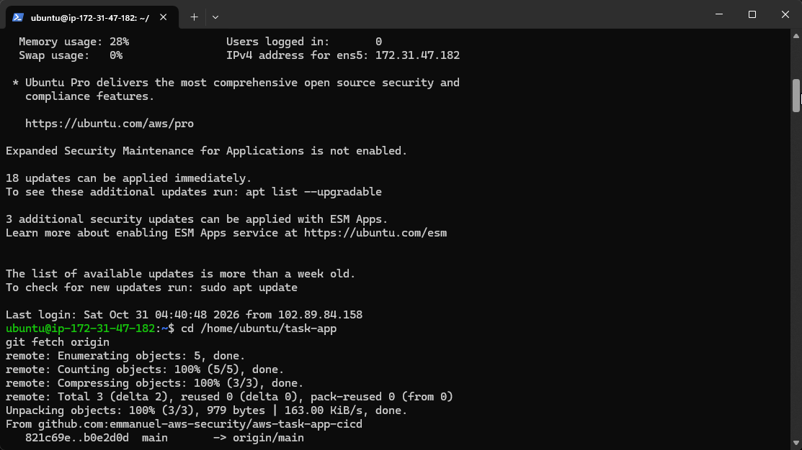
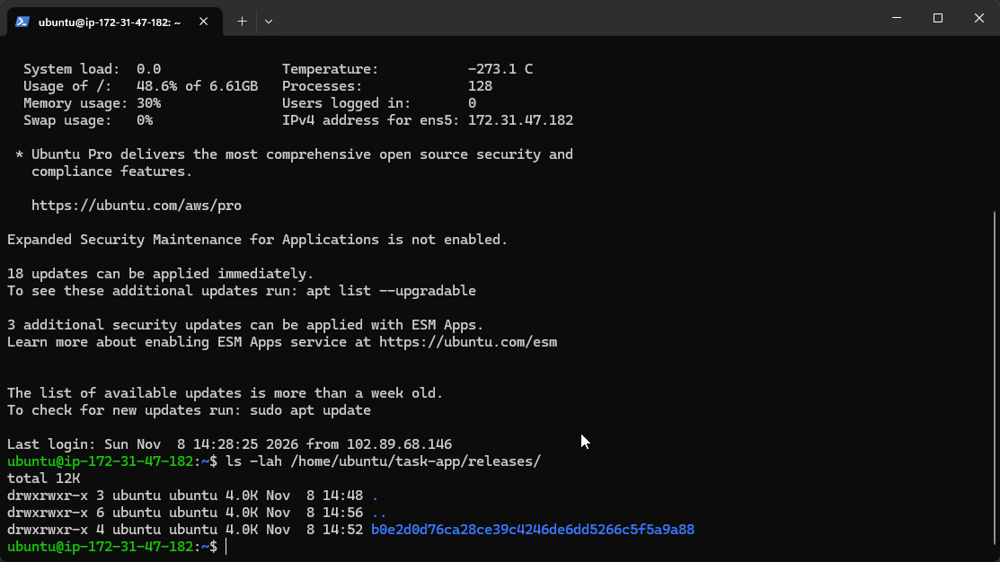
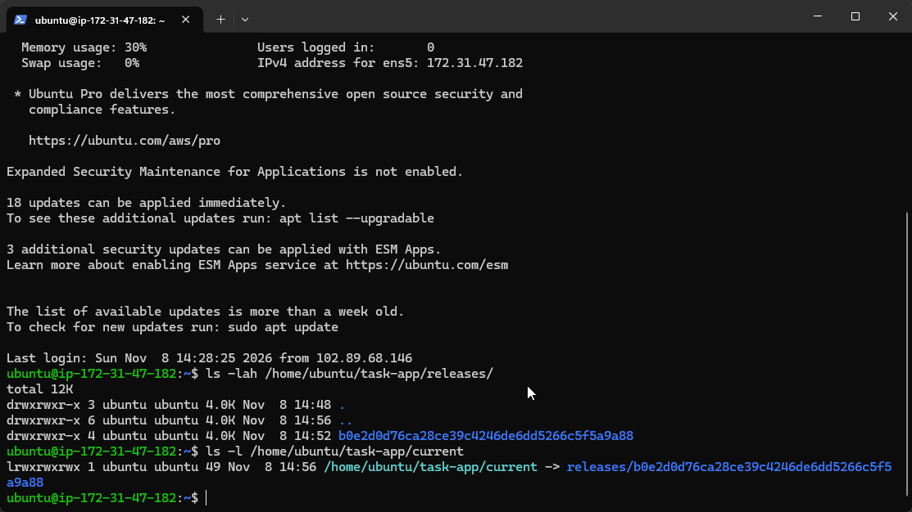
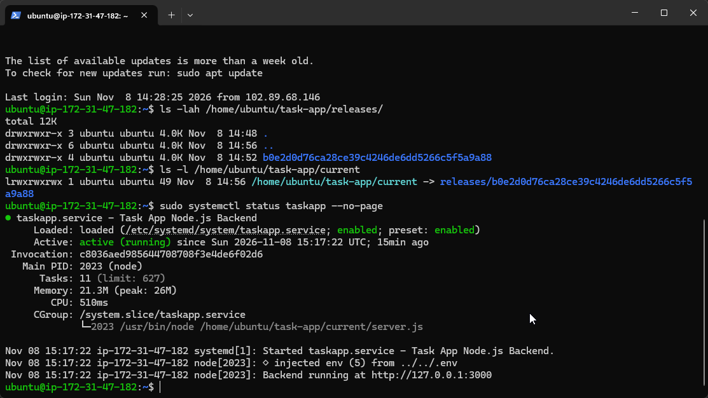
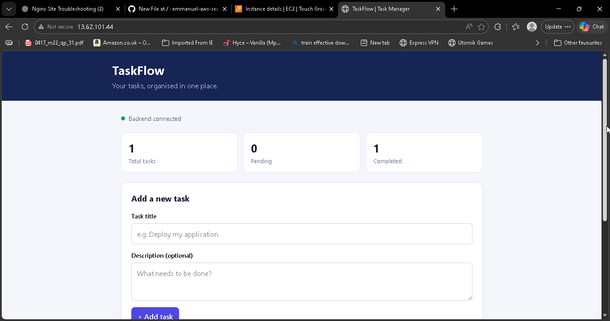
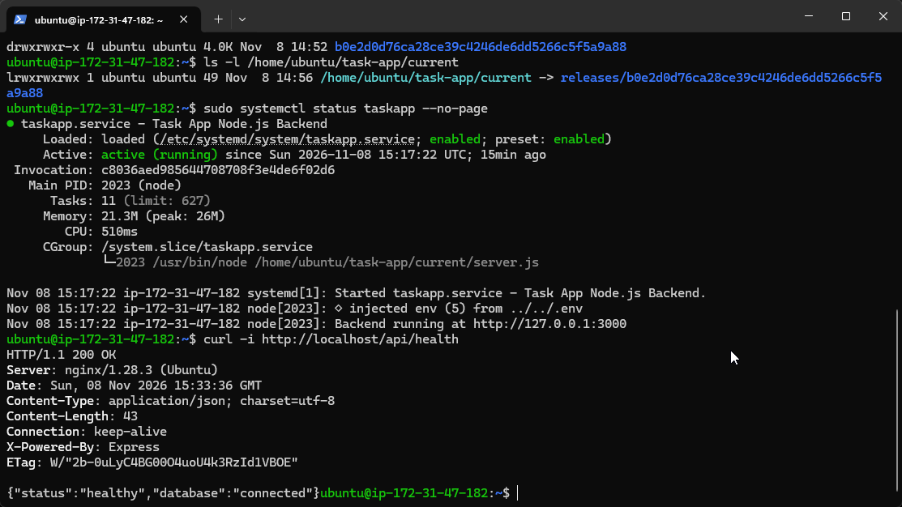

# Learning Notes – AWS EC2 Release-Based Deployment

This document records the important concepts, practical lessons and evidence gathered while completing the AWS EC2 release-based deployment lab.

The goal was not just to get the application running. It was to understand how Git, Linux directories, symbolic links, systemd and Nginx work together when deploying an application.

## 1. Git Fetch vs Git Pull

One of the important decisions in this lab was using:

```bash
git fetch origin
```

instead of:

```bash
git pull
```

`git fetch` retrieves new commits and updates remote-tracking references without integrating those changes into the current working tree.

`git pull` performs a fetch followed by an integration operation, such as a merge or rebase.

For this deployment approach, fetching the latest commit allowed us to extract the exact version of the application we wanted into a separate release directory.

### Evidence



**Screenshot: `01-github-fetch.png`**

This screenshot shows the EC2 instance successfully retrieving updates from the GitHub repository.

It demonstrates the connection between the EC2 instance and GitHub and the use of `git fetch` to retrieve repository updates.

## 2. Commit-Specific Release Directories

Rather than placing every new version of the application into the same directory, we created a separate directory for each release.

The directory name was based on the Git commit ID:

```bash
RELEASE_ID=$(git rev-parse origin/main)
```

This gives each release a unique identifier that can be traced back to a particular version of the source code.

We then extracted the application files into that directory using `git archive`.

The advantage is that the files belonging to one release are kept separate from those belonging to another release.

### Evidence



**Screenshot: `02-release-directory.png`**

This screenshot shows the release directory created for the application.

It demonstrates how application versions can be organised separately instead of continuously overwriting the same application files.

## 3. Understanding Symbolic Links

A symbolic link is a pointer to another file or directory.

In this lab, we created a symbolic link named `current` that points to the release directory being used by the application.

The structure looks like this:

```text
task-app/
│
├── releases/
│   └── <commit-id>/
│
└── current -> releases/<commit-id>
```

The important lesson is that the application does not need to use a different directory path every time a new release is created.

Instead, systemd and Nginx can use the stable `current` path.

The actual release directory is behind that link.

### Evidence



**Screenshot: `03-current-symlink.png`**

This screenshot shows the `current` symbolic link and the release directory it points to.

It demonstrates how a stable directory path can be used to identify the active application release.

## 4. Understanding systemd

systemd is the service manager responsible for starting and managing the Node.js backend.

We configured the service to use:

```ini
WorkingDirectory=/home/ubuntu/task-app/current
ExecStart=/usr/bin/node /home/ubuntu/task-app/current/server.js
```

The `WorkingDirectory` setting determines the directory from which the service runs.

The `ExecStart` setting specifies the command used to start the application.

By using the `current` path in both settings, the service can run the selected release without needing its configuration rewritten for every commit ID.

We also used:

```ini
Restart=always
RestartSec=5
```

This tells systemd to attempt to restart the service if the process exits.

### Evidence



**Screenshot: `04-systemd-service.png`**

This screenshot shows the systemd service running successfully.

It demonstrates that systemd is managing the Node.js backend using the configured application path.

## 5. Understanding Nginx and the Frontend

Nginx acts as the web server in front of the application.

In this lab, its document root was changed from the default web directory to:

```text
/home/ubuntu/task-app/current
```

This allows Nginx to serve the frontend files from the active release directory.

The important concept is that Nginx does not need to know the individual commit ID. It uses the stable `current` path.

### Evidence



**Screenshot: `05-frontend-live.png`**

This screenshot shows the deployed Task App accessible through the browser.

It demonstrates that Nginx can successfully serve the frontend from the configured release directory.

## 6. Understanding Reverse Proxying and Backend Health

The frontend and backend are separate parts of the application.

Nginx serves the frontend and forwards API requests to the Node.js backend running locally on:

```text
127.0.0.1:3000
```

The backend communicates with PostgreSQL to handle application data.

We tested the health endpoint using:

```bash
curl -i http://localhost/api/health
```

The expected response was:

```json
{
  "status": "healthy",
  "database": "connected"
}
```

This is important because a working frontend alone does not prove that the backend or database is working.

The health endpoint gave us evidence that the request reached the backend and that the database connection was successful.

### Evidence



**Screenshot: `06-backend-health.png`**

This screenshot shows the successful API health check.

It demonstrates that Nginx can forward the API request to Node.js and that the backend can communicate with PostgreSQL.

## 7. Troubleshooting Lessons

During the lab, we encountered two important configuration problems.

### Nginx Directory Permissions

The frontend initially failed because Nginx could not traverse the `/home/ubuntu` directory.

The error was:

```text
Permission denied
```

We inspected the directory permissions and corrected the issue using:

```bash
sudo chmod o+x /home/ubuntu
```

This taught me that Linux permissions apply not only to files but also to directories. A process needs execute permission on each parent directory to traverse a path.

### systemd ExecStart Configuration

The backend initially failed because the `ExecStart` command had accidentally been joined to the `Restart=always` setting.

The journal showed that systemd was trying to load a file named:

```text
server.jsRestart=always
```

This taught me that systemd service files are configuration files with specific syntax. A misplaced setting can prevent an otherwise working application from starting.

The issue was resolved by restoring the correct service configuration, reloading systemd and restarting the backend.

## 8. Key Lessons Learned

1. `git fetch` lets me retrieve repository updates without directly changing the current working files.
2. Commit-specific release directories keep different application versions separate.
3. A symbolic link provides a stable path to the selected release.
4. systemd can manage a Node.js application as a Linux service.
5. Nginx can serve frontend files and reverse proxy API requests to a backend.
6. Linux directory permissions affect whether services can access application files.
7. A successful frontend response does not automatically mean the backend and database are healthy.
8. Logs are essential for identifying configuration and service failures.

## Final Understanding

The biggest lesson from this lab is understanding how the different components fit together.

Git retrieves the application code. The release directory stores a specific version. The `current` symbolic link identifies the release being used. systemd runs the backend from that location, while Nginx serves the frontend and forwards API requests to the backend.

This gives the application a more organised release structure than simply replacing files in one live directory.

**Note:** This lab establishes the release-based structure. Automated deployment, automatic release switching and rollback were not implemented or tested in this exercise.
